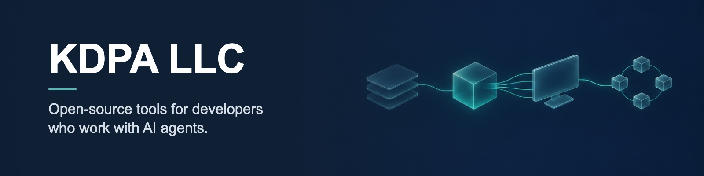
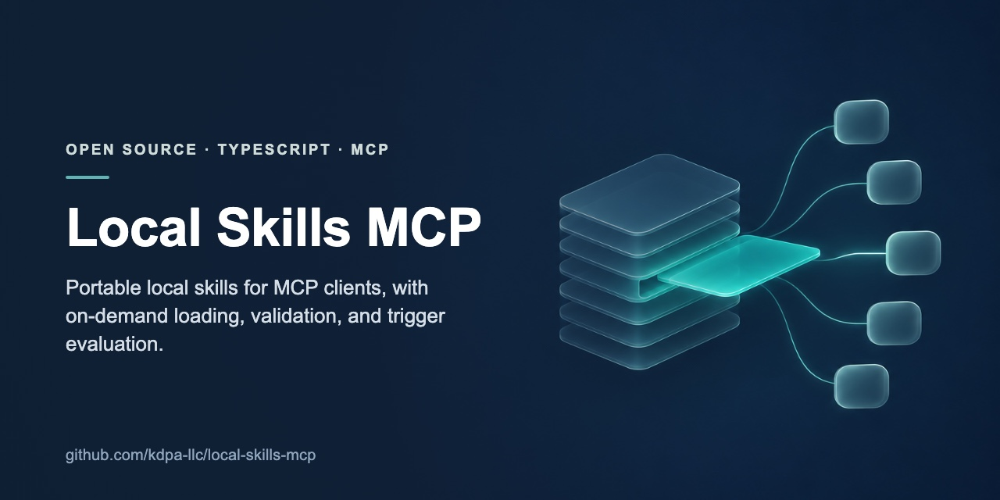
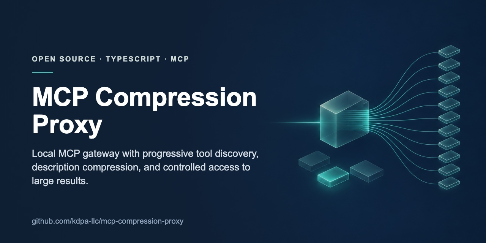
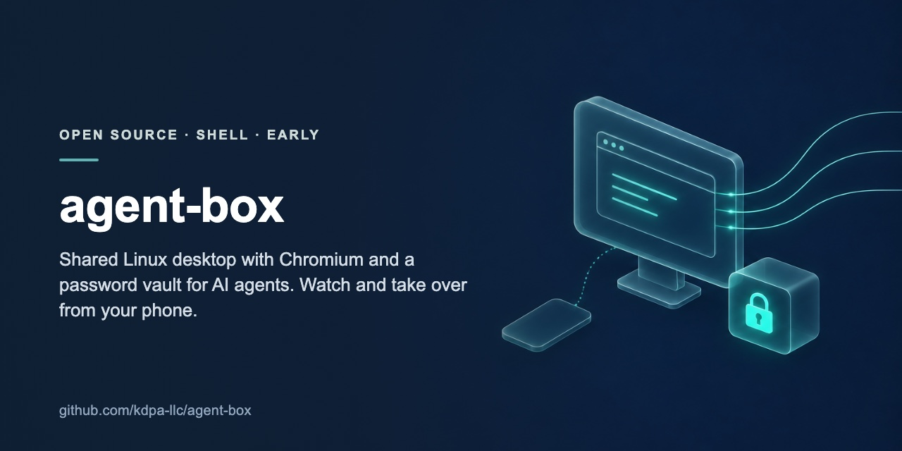
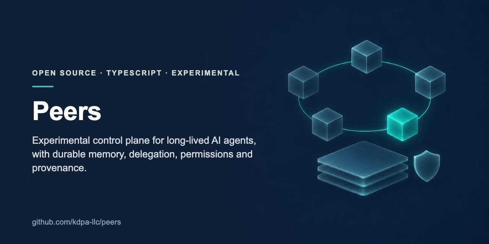

<p>
<a href="https://github.com/kdpa-llc/local-skills-mcp"></a>
<a href="https://github.com/kdpa-llc/mcp-compression-proxy"></a>
<a href="https://github.com/kdpa-llc/agent-box"></a>
<a href="https://github.com/kdpa-llc/peers"></a>
</p>

## Projects

- **[Local Skills MCP](https://github.com/kdpa-llc/local-skills-mcp):** portable local skills for MCP-compatible agents and clients, with on-demand loading, validation, hot reload, multi-source discovery and trigger evaluation.
- **[MCP Compression Proxy](https://github.com/kdpa-llc/mcp-compression-proxy):** a local MCP gateway with progressive tool discovery, context-efficient schema access through its CLI or lazy-exposure mode, shaped results, large-output controls, and aggregation of local and remote MCP servers.
- **[agent-box](https://github.com/kdpa-llc/agent-box), early:** a shared Linux desktop with Chromium and a password vault for the AI agents on your Mac or Linux machine. Agents drive the browser with playwright-cli, and you can watch and take over from your phone.
- **[Peers](https://github.com/kdpa-llc/peers), experimental:** a control plane for long-lived AI agents, with identity, durable memory, delegation, permissions, budgets and provenance.

## Get started

Both MCP tools are on npm:

```sh
npm install -g local-skills-mcp
npm install -g mcp-compression-proxy
```

Each project's README covers the rest of the setup.

## How the projects are built

The projects are built through specification and AI agent orchestration. A maintainer sets the problem, design, constraints and acceptance bar. AI agents implement and test in scoped steps, and a maintainer reviews and accepts the result.

- Problems, constraints, contracts, tradeoffs and limits are written down.
- Deterministic checks are combined with adversarial or model-based evaluation where it fits.
- Each project documents its security and execution limits. Experimental projects are labeled experimental, not presented as production-ready.

Every project uses the MIT License. Read its README and security notes before you use it with systems or data you care about.

## Contact

[Rafael Konrath Damaceno](https://github.com/moscaverd) is one of the founders of KDPA LLC and one of the active contributors to its repositories.

For questions about a project, open an issue in its repository.
